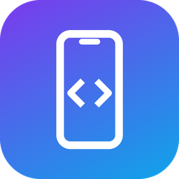

<p align="center"></p>

# IrisPhone

**Make iPhone apps on Windows. No Mac, no Xcode, no paid account.**

IrisPhone installs everything needed to build Swift apps for iOS on a Windows PC (or Linux), signs them
with your Apple ID and installs them on your iPhone over USB, in one command. It is built to work hand in
hand with [Claude Code](https://claude.com/claude-code): Claude writes the app, builds it, installs it on your phone
and reads its logs by itself.

[Français](README.fr.md)

```powershell
# Windows (PowerShell)
irm https://raw.githubusercontent.com/Iris-universe/IrisPhone/main/install.ps1 | iex
```

```sh
# Linux (Ubuntu/Debian)
curl -fsSL https://raw.githubusercontent.com/Iris-universe/IrisPhone/main/install.sh | sh
```

The installer puts `irisphone` on your PATH and runs `irisphone setup`, which walks you through the rest.

## Your first app

```sh
irisphone new MyApp      # or: irisphone new MyApp --template webview
cd MyApp
irisphone run            # builds, signs, installs and launches it on the iPhone
```

First install only, on the iPhone: **Settings > General > VPN & Device Management** > your Apple ID > **Trust**,
and **Settings > Privacy & Security > Developer Mode** > On.

## With Claude Code

Every project created by `irisphone new` contains a `CLAUDE.md` (what works and what doesn't without Xcode)
and a `.mcp.json` that gives Claude these tools:

| Tool | What Claude does with it |
|------|--------------------------|
| `irisphone_build` | Compiles after each change and gets the errors with the right `file:line` |
| `irisphone_run` | Installs the app on your iPhone and launches it |
| `irisphone_logs` | Reads what the app prints while you try it |
| `irisphone_doctor` | Finds out why something doesn't work and tells you the fix |
| `irisphone_new_app`, `_launch`, `_uninstall`, `_devices`, `_project_info` | The rest |

```sh
cd MyApp
claude
> add a tab with a to-do list saved on the phone, then install it
```

`irisphone setup` also offers to register the tools for all your projects (`irisphone claude` does it later).
There is also a Claude Code plugin with an iOS skill:

```
/plugin marketplace add Iris-universe/IrisPhone
/plugin install irisphone@irisphone
```

## Commands

| Command | |
|---------|--|
| `irisphone setup` | Install / repair everything. Safe to re-run |
| `irisphone doctor` | Check each part of the chain, with the fix for anything broken (`--json` for scripts) |
| `irisphone new <Name>` | New project (`--template swiftui` or `webview`) |
| `irisphone build` | Compile (no iPhone needed). `--ipa` produces a signed `.ipa` |
| `irisphone run` | Build + install + launch on the iPhone (alias: `deploy`) |
| `irisphone logs` | Stream the app's logs (`print`, `os.Logger`, crashes) |
| `irisphone launch` / `uninstall` | Start or remove the app on the iPhone |
| `irisphone login` / `logout` | Apple ID used to sign |
| `irisphone devices` / `pair` | Connected iPhones / trust this computer |
| `irisphone config` | Settings: `bundle_prefix`, `distro`, `apple_id` |
| `irisphone claude` | Register the MCP server in Claude Code |

## Templates

- **swiftui**: a native SwiftUI app.
- **webview**: your app in HTML/CSS/JS inside a native shell, with a small JS ↔ Swift bridge
  (storage, haptics, share sheet, device info). Open `index.html` in a desktop browser to work on it,
  `irisphone run` to try it on the phone.

## How it works

```
Windows                                 WSL (Ubuntu)                              iPhone
irisphone.exe ──────────────────────▶  Swift 6 + iOS SDK + xtool  ── build, sign ──┐
Apple Devices (Microsoft Store)  ◀───  usbmuxd over 127.0.0.1:27015 ◀──────────────┘ USB
```

- [xtool](https://github.com/xtool-org/xtool) does the heavy lifting: building SwiftPM apps for iOS on Linux,
  signing with an Apple ID (free accounts included) and installing.
- The iOS SDK is extracted from the Xcode `.xip` that **you** download from Apple (its license doesn't allow
  redistribution). `irisphone setup` opens the page and waits for the download.
- On Windows, Apple's own USB driver comes from the **Apple Devices** app; WSL reaches it through
  [mirrored networking](https://learn.microsoft.com/windows/wsl/networking#mirrored-mode-networking).

More details in [docs/how-it-works.md](docs/how-it-works.md). Problems: [docs/troubleshooting.md](docs/troubleshooting.md).

## Requirements and limits

- Windows 11 (22H2+) with WSL 2, or Ubuntu/Debian. About 12 GB of disk once installed (Swift + iOS SDK);
  keep ~30 GB free during setup for the Xcode download and its extraction.
- A free Apple ID works, with Apple's limits: apps expire after **7 days** (run `irisphone run` again),
  3 sideloaded apps at once, 10 new bundle IDs per week, no push notifications, iCloud or App Groups.
  A paid developer account ($99/year) removes them.
- No iOS Simulator: you test on a real iPhone or iPad.
- Publishing to the App Store needs a paid account; `irisphone build --ipa` makes the `.ipa`, but uploading
  it to App Store Connect isn't handled yet.
- Not affiliated with Apple. Make sure your use of the Xcode SDK follows Apple's license.

## Roadmap

- Desktop app (Tauri) on top of the same engine
- Wi-Fi install, more templates, App Store upload
- Your idea? [Open an issue](https://github.com/Iris-universe/IrisPhone/issues).

## Contributing

Contributions are welcome: see [CONTRIBUTING.md](CONTRIBUTING.md). IrisPhone is written in Rust;
the Linux side is a bash script embedded in the binary.

## License

[MIT](LICENSE). IrisPhone stands on [xtool](https://github.com/xtool-org/xtool) (MIT),
[libimobiledevice](https://libimobiledevice.org) and [Swift](https://swift.org).
